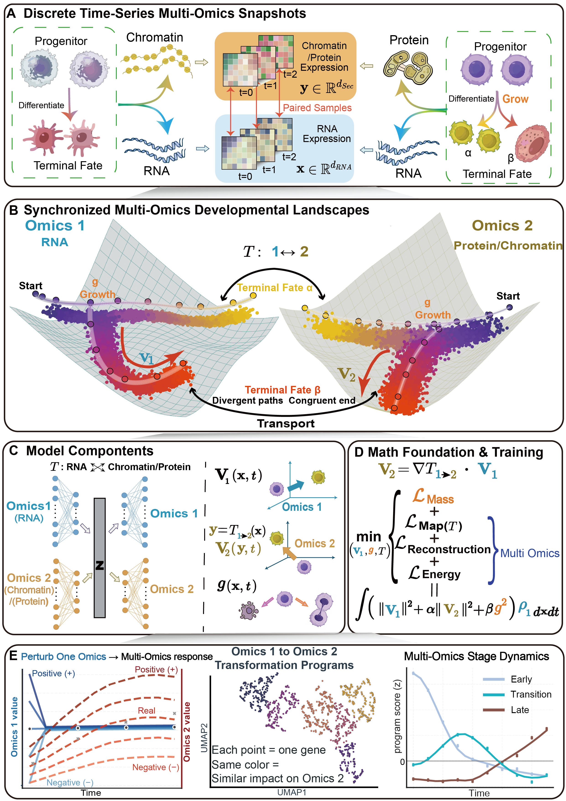

# MOFI: Multi-Omics Fate Inference

MOFI reconstructs continuous cell-state dynamics from time-series single-cell multi-omics data. It combines cross-modality mapping with models of cell-state change and population growth to study developmental trajectories, cell fates and molecular perturbations.



## System requirements and installation

The notebooks have been exercised with Python 3.10 and PyTorch 2.6.0 with CUDA 12.4 on Windows and Linux with NVIDIA GPUs. The biological analyses use substantial memory and disk space; running times depend on the dataset and hardware. CPU-only execution has not been validated for the complete notebooks.

Create a clean Python 3.10 environment and install the CUDA 12.4 build of PyTorch before installing the remaining dependencies. For example, from the repository root:

```bash
git clone https://github.com/jiantaoShen12/MOFI.git
cd MOFI
conda create -n mofi python=3.10 -y
conda activate mofi
python -m pip install torch==2.6.0 --index-url https://download.pytorch.org/whl/cu124
python -m pip install -r requirements.txt
python -m pip install -e .
python -m pip check
python scripts/check_paper_data.py
jupyter lab
```

Install a compatible NVIDIA driver before running with CUDA. The Windows Sankey figure export uses Microsoft Edge in headless mode; Linux uses Kaleido. The fitted UMAP models require the versions specified in `requirements.txt`. See [data notes](paper_data/README.md) for the processed inputs, source datasets and fitted models used by the biological notebooks.

## Examples

The notebooks cover a simulation benchmark and four biological datasets. They include previews generated by running the notebooks, so figures can be inspected on GitHub before execution. Rerunning the notebooks generates fresh, full-resolution figures locally.

To execute a notebook from the command line using an installed Jupyter kernel:

```bash
python scripts/execute_notebook.py notebooks/00_simulation_training_and_figure2.ipynb
```

The runner uses the Python environment that invokes it and writes the executed notebook under `results/executed/`, leaving the source notebook unchanged. Run the other notebooks by substituting their paths. Results and intermediate files are written under `results/`.

| Notebook | Analysis |
| --- | --- |
| [Simulation](notebooks/00_simulation_training_and_figure2.ipynb) | Trajectories, potential landscape and growth rates |
| [Kidney organoids](notebooks/01_gse213152_and_figure3.ipynb) | RNA–ATAC dynamics, cell fates and marker expression |
| [HSPCs](notebooks/02_hspc_31800_and_figure4.ipynb) | RNA–protein dynamics and MkP perturbation |
| [Human organoids](notebooks/03_human_organoid_and_figure5.ipynb) | Developmental programs and NKX2-1 dynamics |
| [Cortical development](notebooks/04_cortical_development_and_figure6.ipynb) | Lineage transitions and ERBB4 perturbation |

## Simulation runtime

Open `notebooks/00_simulation_training_and_figure2.ipynb` to run the supplied simulation. The recorded simulation training run took approximately **152 seconds** using CUDA. This timing excludes installation and downstream figure generation.

## Code

Paths below are relative to the repository root.

| Directory | Contents |
| --- | --- |
| `src/` | MOFI implementation in `CytoBridge/`, with the `mofi/` import alias. `Map/` handles cross-modality mapping, `tl/` simulation fitting and dynamics, `pp/` preprocessing, and `pl/` plotting and perturbation analysis. |
| `configs/` | Simulation training, analysis and perturbation settings, with selected cell indices and gene lists in `analysis_inputs/`. |
| `notebooks/` | Simulation training and analyses for Figures 2–6; `mofi_notebook.py` provides shared notebook helpers. |
| `scripts/` | Notebook execution and simulation data generation, training, evaluation and plotting. |
| `datasets/simulation/` | Simulation inputs and reference gene-expression values. |
| `models/simulation/` | Fitted simulation models and evaluation results. |
| `downstream/plotting/` | Additional plotting routines for the biological analyses. |
| `paper_data/` | Processed biological inputs, fitted models, projections and source notes for the notebooks. |
| `web/` | Interactive website, paper figures in `assets/`, and sampled trajectories in `demo_data/`. |

## Interactive examples

The [web demo](https://jiantaoshen12.github.io/MOFI/) shows simulated and kidney organoid trajectories. To view it locally, run this command from the repository root:

```bash
python -m http.server 8000 --directory web
```

Open <http://localhost:8000/> in your browser. The demo uses sampled trajectories and illustrative animations; it does not run model inference.

## Citation

The paper citation will be added after publication.

## License

[MIT](LICENSE).
